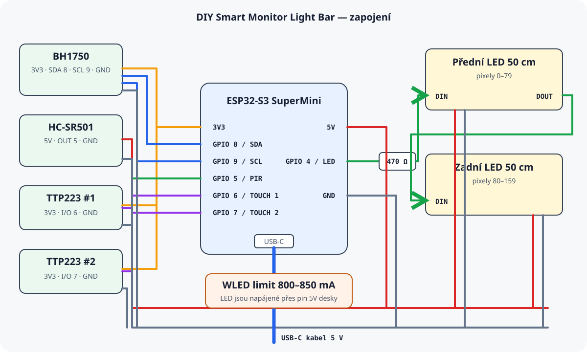

# DIY Smart Monitor Light Bar

Chytrá světelná lišta nad monitor postavená na **ESP32-S3 SuperMini** a **WLED**. Projekt kombinuje pracovní světlo směřující na stůl, ambientní podsvícení za monitorem, automatické zapnutí pomocí PIR senzoru a regulaci jasu podle okolního osvětlení.

## Hlavní funkce

- 50 cm COB RGB pásku jako přední pracovní světlo
- 50 cm stejného pásku jako ambientní podsvícení monitoru
- automatické zapnutí při detekci pohybu
- měření okolního světla senzorem BH1750
- automatický nebo ruční jas
- dvě kapacitní tlačítka:
  - zapnutí/vypnutí světla
  - přepnutí automatického a ručního jasu
- ovládání přes Wi-Fi pomocí WLED
- gravitační 3D tištěný držák bez vrtání do monitoru

## Hardware

- ESP32-S3 SuperMini
- Waveshare RGB COB LED pásek, 5 V, 1 m, WS2812B, 160 LED/m
- BH1750 / GY-302
- PIR HC-SR501
- 2× TTP223
- 470 Ω rezistor v datové lince
- 470 µF kondenzátory na napájení LED
- USB-C napájecí kabel
- hliníkový profil nebo pásovina
- PETG nebo ASA pro tištěné díly

Podrobný seznam je v [docs/BOM.md](docs/BOM.md).

## Zapojení

| Funkce | GPIO ESP32-S3 |
| --- | ---: |
| Data LED pásku | 4 |
| PIR výstup | 5 |
| TTP223 – zapnutí/vypnutí | 6 |
| TTP223 – automatický/ruční jas | 7 |
| BH1750 SDA | 8 |
| BH1750 SCL | 9 |

Kompletní zapojení a poznámky jsou v [docs/WIRING.md](docs/WIRING.md).

## Napájení

Aktuální návrh používá USB-C kabel zapojený přímo do ESP32-S3. LED pásek je napájený z pinu `5V` desky. Kvůli proudové cestě přes desku musí být ve WLED nastaven limit přibližně **800–850 mA**.

Celý pásek má jmenovitý příkon až 12 W, takže v této konfiguraci nemůže běžet na plný jas. Pozdější varianta může použít samostatné rozbočení 5 V před deskou ESP32.

## Firmware

Projekt počítá s vlastním buildem WLED pro ESP32-S3. Standardní BH1750 usermod pouze čte intenzitu osvětlení; pro skutečnou automatickou regulaci jasu a její přepínání tlačítkem bude potřeba vlastní malý usermod.

Plánované chování:

- `TTP223 #1`: světlo `ON/OFF`
- `TTP223 #2`: režim `AUTO/MANUAL`
- při vypnutí automatiky se zachová aktuální jas
- při zapnutí automatiky se jas plynule řídí hodnotou lux
- stav režimu se uloží a obnoví po restartu

Další podrobnosti jsou v [docs/WLED.md](docs/WLED.md).

## Mechanická konstrukce

- přední lišta skloněná přibližně 35–45° směrem na stůl
- spodní stínicí kšilt 8–12 mm proti odleskům na displeji
- hliníkový podklad pod COB páskem pro odvod tepla
- zadní protiváha obsahující ESP32, kabeláž a závaží
- BH1750 míří nahoru nebo dozadu mimo přímý svit lišty
- PIR míří dopředu a šikmo dolů k židli
- dotykové moduly jsou schované pod tenkou stěnou PETG

Mechanické požadavky jsou shrnuté v [docs/MECHANICAL.md](docs/MECHANICAL.md).

## Stav projektu

- [x] Základní architektura
- [x] Výběr a objednání elektroniky
- [x] Návrh pinů
- [ ] Ověření skutečného počtu adresovatelných pixelů pásku
- [ ] Test zapojení na stole
- [ ] WLED build s automatickým jasem
- [ ] 3D model gravitačního držáku
- [ ] Montáž a kalibrace

## Bezpečnost

- Před stříháním nebo pájením vždy odpojit napájení.
- Dodržet polaritu elektrolytických kondenzátorů.
- Všechny části musí mít společnou zem.
- Nepřekročit proudový limit desky při napájení LED přes její pin `5V`.
- Nepřipojovat současně různé 5V zdroje bez ověření jejich zapojení.

