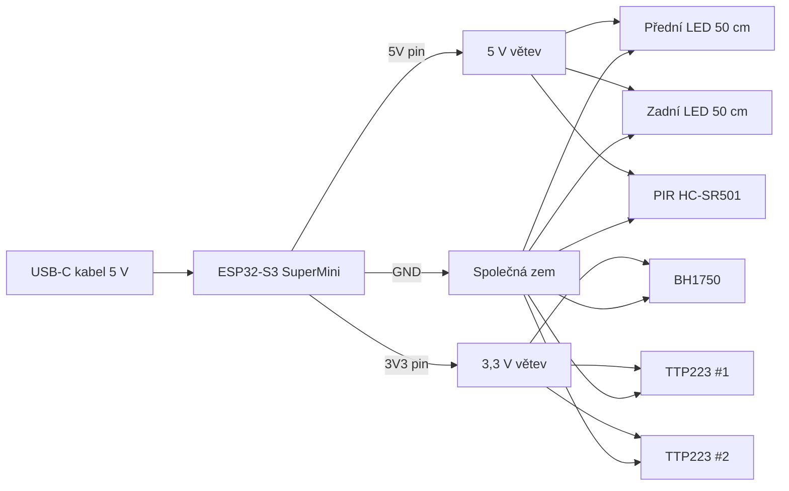

# Zapojení

## Pinout

| Periferie | Pin periferie | ESP32-S3 SuperMini | Poznámka |
| --- | --- | --- | --- |
| Přední LED | DIN | GPIO 4 | přes rezistor 470 Ω |
| Přední LED | DOUT | DIN zadní LED | datové řetězení |
| Obě LED části | +5 V | 5V | paralelní napájení |
| Obě LED části | GND | GND | společná zem |
| PIR HC-SR501 | VCC | 5V | napájení senzoru |
| PIR HC-SR501 | OUT | GPIO 5 | logická úroveň 3,3 V |
| PIR HC-SR501 | GND | GND | společná zem |
| TTP223 #1 | VCC | 3V3 | zapnutí/vypnutí |
| TTP223 #1 | I/O | GPIO 6 | aktivní HIGH |
| TTP223 #1 | GND | GND | společná zem |
| TTP223 #2 | VCC | 3V3 | automatický/ruční jas |
| TTP223 #2 | I/O | GPIO 7 | aktivní HIGH |
| TTP223 #2 | GND | GND | společná zem |
| BH1750 | VCC | 3V3 | nenapájet z 5 V |
| BH1750 | SDA | GPIO 8 | I²C data |
| BH1750 | SCL | GPIO 9 | I²C clock |
| BH1750 | GND | GND | společná zem |

## Datové zapojení LED

```text
GPIO 4 ── 470 Ω ── DIN [přední LED 0–79] DOUT ── DIN [zadní LED 80–159]
```

Směr musí souhlasit se šipkami vyznačenými na pásku.

## Napájení



## Kondenzátory

Kondenzátor 470 µF připojit paralelně mezi `+5V` a `GND` co nejblíže napájecímu vstupu LED. Kladný vývod patří na `+5V`, záporný vývod označený pruhem na `GND`.

## Proudové omezení

Při napájení USB-C kabelem přímo do ESP32 a následně přes pin `5V` nastavit ve WLED proudový limit přibližně **800–850 mA**. Celý metr pásku má jmenovitý odběr až přibližně 2,4 A, takže plný výkon není v této variantě dostupný.

## Poznámka k logickým úrovním

WS2812B používá 5V logiku a ESP32 vysílá 3,3 V. Krátké datové vedení často funguje přímo, ale při nestabilitě nebo blikání doplnit převodník úrovní `74AHCT125` nebo `74HCT14`.

